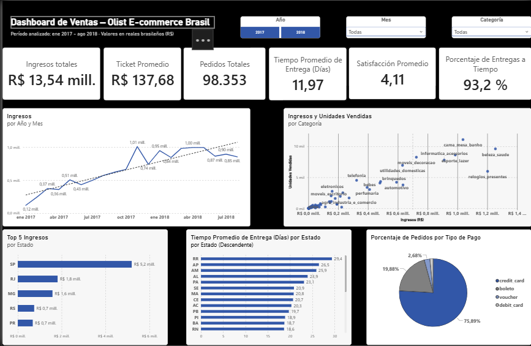
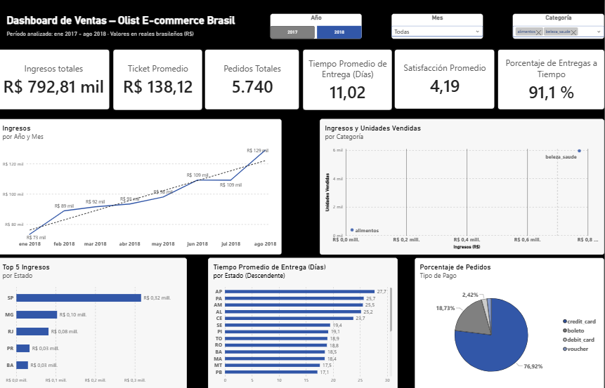

# Brazilian E-commerce Pipeline

## Descripción

Este proyecto implementa un pipeline de integración de datos utilizando **Python** y **Pandas** sobre el conjunto de datos público de **Olist Brazilian E-commerce**.

El objetivo es consolidar la información distribuida en múltiples tablas relacionales en una única **tabla analítica**, lista para realizar análisis exploratorios, construir visualizaciones y generar indicadores de negocio.

Durante el proceso se aplican validaciones de cardinalidad mediante `pandas.merge(validate=...)`, garantizando que las relaciones entre las tablas respeten el modelo de datos original y ayudando a detectar inconsistencias durante la integración.

## Objetivos

* Integrar la información del dataset de Olist en una tabla analítica centralizada.
* Aplicar buenas prácticas de organización y modularización del código.
* Validar las relaciones entre tablas durante el proceso de integración utilizando `pandas.merge(validate=...)`.
* Garantizar la calidad de los datos antes de cargarlos a MySQL mediante un sistema de contratos por tabla.
* Documentar el modelo de datos y el flujo del pipeline mediante diagramas técnicos.
* Preparar una base de datos lista para posteriores análisis y visualizaciones en Power BI.

## Arquitectura

El proyecto está dividido en dos pipelines independientes, cada uno con su propio punto de entrada:

| Pipeline | Archivo | Qué hace |
|---|---|---|
| Tablas individuales | `src/main.py` | Extrae, transforma y carga a MySQL las siete tablas originales del dataset, respetando su esquema relacional |
| Tabla analítica | `src/build_analytical_table.py` | Fusiona las siete tablas en una sola tabla desnormalizada, enriquecida con métricas de negocio, y la carga a su propia tabla en MySQL |

Antes de cargar cualquier tabla a MySQL, cada una pasa por una validación de contrato (`src/contracts.py` + `src/inspector.py`): se verifica que las columnas esperadas existan, que los tipos de dato sean compatibles, y que la clave primaria no tenga nulos ni duplicados. Si alguna tabla no cumple, el pipeline se detiene antes de cargar nada.

## Dataset

El proyecto utiliza el conjunto de datos **Brazilian E-commerce Public Dataset by Olist**, que contiene información sobre pedidos realizados entre 2016 y 2018 en la plataforma de comercio electrónico Olist.

Las tablas empleadas en este proyecto incluyen:

* `customers`
* `orders`
* `order_items`
* `products`
* `order_payments`
* `order_reviews`
* `sellers`

Cada una de ellas se integra progresivamente para construir la tabla analítica.

---
## Instalación y uso

### 1. Clonar el repositorio
```bash
git clone https://github.com/Devanycode/brazilian-ecommerce-pipeline.git
cd brazilian-ecommerce-pipeline
```

### 2. Crear entorno virtual e instalar dependencias
```bash
python -m venv .venv
source .venv/bin/activate      # Windows: .venv\Scripts\activate
pip install -r requirements.txt
```

### 3. Descargar el dataset
Este proyecto usa el dataset público **Brazilian E-Commerce Public Dataset by Olist**:
https://www.kaggle.com/datasets/olistbr/brazilian-ecommerce

Descarga el ZIP y coloca los siguientes archivos dentro de la carpeta `data/`:
- olist_customers_dataset.csv
- olist_orders_dataset.csv
- olist_order_items_dataset.csv
- olist_products_dataset.csv
- olist_order_payments_dataset.csv
- olist_order_reviews_dataset.csv
- olist_sellers_dataset.csv

### 4. Configurar variables de entorno
```bash
cp .env.example .env
```
Y completa tus credenciales de MySQL en `.env`.

### 5. Ejecutar el pipeline
```bash
cd src
python main.py                  # Carga las tablas originales
python build_analytical_table.py  # Construye y carga la tabla analítica
```

---
## Dashboard

Dashboard en Power BI construido sobre la tabla analítica (`brazilian_ecommerce.tabla_analitica` en MySQL). Responde: cuánto se vende, dónde, en qué categorías, qué tan rápido se entrega y qué tan satisfechos quedan los clientes.

### Capturas

**Vista general**


**Vista filtrada (año 2018, categorías alimentos y beleza_saude)**


### Qué incluye

| Elemento | Detalle |
|---|---|
| KPIs (6) | Ingresos Totales, Ticket Promedio, Pedidos Totales, Tiempo Promedio de Entrega, Satisfacción Promedio, Porcentaje de Entregas a Tiempo |
| Gráficos (5) | Ingresos por año y mes, ingresos y unidades vendidas por categoría, Top 5 ingresos por estado, tiempo de entrega por estado, pedidos por tipo de pago |
| Filtros (3) | Año, Mes, Categoría |

### Alcance y límites

- **Periodo:** enero 2017 – agosto 2018 (detalle en [`dax_documentation.md`](docs/dax_documentation.md#contexto-de-reporte)).
- **Ingresos:** suma de `price`, sin incluir el valor del envío.
- **Pedidos sin ítems** (775 en el dataset) no aparecen porque la tabla analítica los excluye al unir con `order_items`.
- Las funciones de `src/analytics.py` usan toda la información histórica (2016–2018), por lo que sus totales no coinciden con los del dashboard que está filtrado.

### Cómo abrirlo

1. Instala [Power BI Desktop](https://powerbi.microsoft.com/desktop) (gratuito, solo Windows).
2. Abre `powerbi/dashboard_olist.pbix`. Los datos vienen incluidos, no necesitas MySQL excepto si quieres usar 'Actualizar'.


### Documentación

| Documento | Contenido |
|---|---|
| [`docs/data_model.md`](docs/data_model.md) | Tablas, llaves y relaciones del dataset |
| [`docs/dax_documentation.md`](docs/dax_documentation.md) | Medidas y columnas DAX, con su lógica |
| [`docs/dashboard_charts.md`](docs/dashboard_charts.md) | Explicación detallada de las gráficas usadas |

---
## Próximas mejoras

- Definir claves primarias y foráneas reales a nivel de base de datos.
- Automatizar la actualización de los datos mediante un script programado.
- Implementar pruebas automatizadas.
- Optimizar el pipeline para facilitar su reutilización con nuevos datasets.