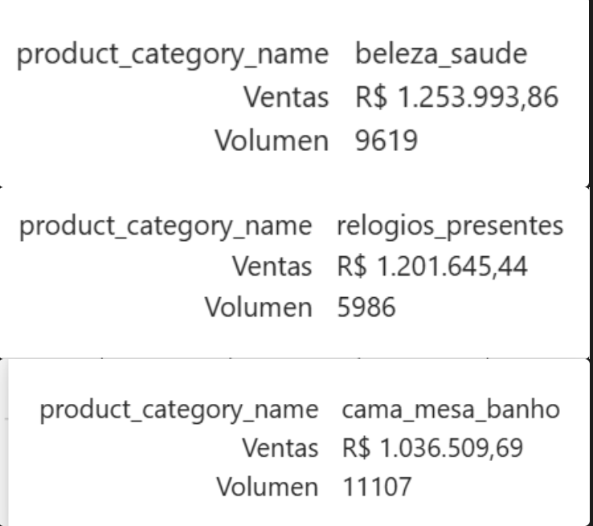
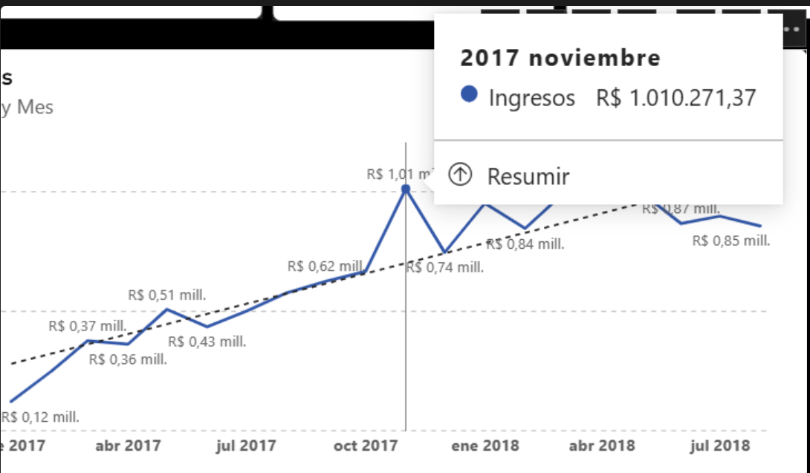
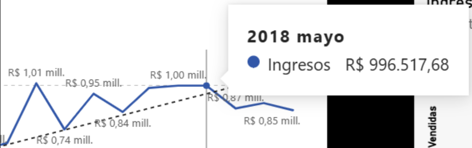
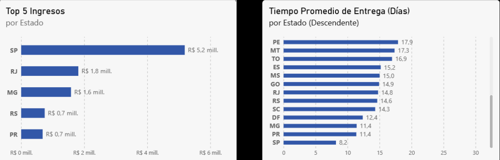
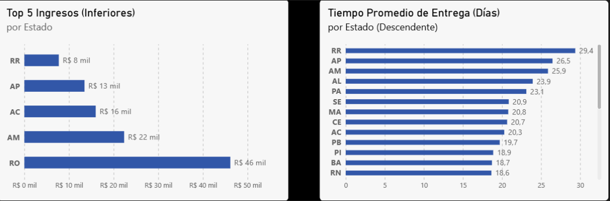
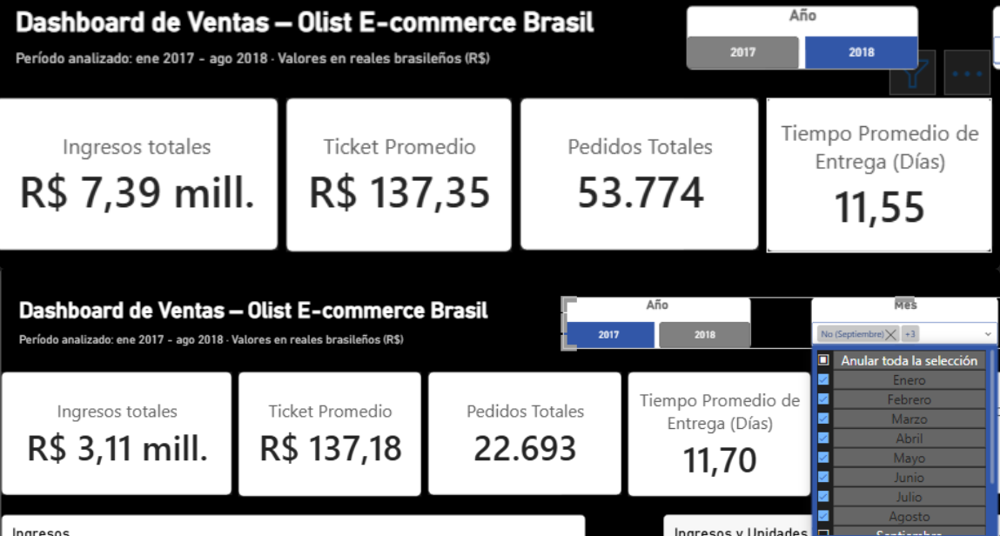
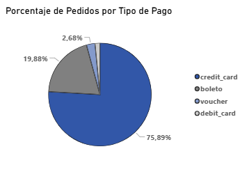

# Análisis de Negocio 

En este documento se realizarán análisis de negocio, extraídos de los datos que podemos ver en las gráficas del dashboard, complementado con consultas SQL o en Python con Pandas en caso de ser necesario. 


## Comparativa de Categorías Top



Aunque los productos que más se venden son de la categoría `cama_mesa_banho`, los productos que más generan ingresos son de las categorías `beleza_saude` y `relogios_presentes`, esta última incluso con 5.121 ventas de diferencia con la más vendida. 

Esto puede indicar que las personas compran mucho la categoría más vendida precisamente por sus precios bajos. 

```mysql
SELECT 
	product_category_name AS categoria,
    ROUND(AVG(price), 2) AS precio_promedio
FROM tabla_analitica
WHERE product_category_name IN ('beleza_saude', 'relogios_presentes', 'cama_mesa_banho')
GROUP BY categoria;
```

*Esta consulta incluye todo el histórico y no está filtrada*

| categoria          | precio_promedio |
| ------------------ | --------------- |
| cama_mesa_banho    | 93.3            |
| beleza_saude       | 130.16          |
| relogios_presentes | 201.14          |

Aquí se ve claramente que los precios en promedio son mucho más elevados para las categorías de más ingresos en comparación con la categoría de más unidades vendidas, lo que nos explica la diferencia tan grande que hay en relación a unidades vendidas vs ingresos totales. 


## Pico de Noviembre



Hubo un pico de ingresos en Noviembre del 2017.
En ese año hubo picos históricos en compras electrónicas debido al `Black Friday` y `Cyber Monday`.
En Brasil hay una ley de liquidación o aguinaldo `13º salario`([Lei nº 4.090, de 13 de julho de 1962](https://www.tst.jus.br/13-salario)) que se da a más tardar el 30 de Noviembre, para algunos esa liquidación llegó para los períodos de Black Friday, lo que puede indicar que existen las condiciones para que haya existido ese pico, que incluso decayó en Diciembre y en Octubre fue aún más bajo. 

```mysql
WITH 
ventas_black_friday AS (
	SELECT 
		COUNT(*) AS unidades_vendidas_bf, 
		SUM(price) AS ingresos_totales_bf
	FROM tabla_analitica
	WHERE order_purchase_timestamp < '2017-11-28 00:00:00' AND 
		  order_purchase_timestamp >= '2017-11-24 00:00:00'
),
ventas_mes AS (
	SELECT 
		COUNT(*) AS unidades_vendidas_mes,
		SUM(price) AS ingresos_totales_mes
	FROM tabla_analitica
    WHERE order_purchase_timestamp >= '2017-11-01 00:00:00' 
      AND order_purchase_timestamp < '2017-12-01 00:00:00'
)
SELECT 
	ROUND(unidades_vendidas_bf / unidades_vendidas_mes * 100, 2) AS porcentaje_unidades_black_friday,
	ROUND(ingresos_totales_bf / ingresos_totales_mes * 100, 2) AS porcentaje_ingresos_black_friday
FROM ventas_black_friday, ventas_mes
```
| porcentaje_unidades_black_friday | porcentaje_ingresos_black_friday |
| -------------------------------- | -------------------------------- |
| 33.19                            | 30.37                            |

Con esta consulta podemos observar que el 30,37% de los ingresos y el 33,19% de las unidades vendidas de todo el mes se realizaron en los 4 días que dura el evento de `Black Friday`, que comenzó el viernes 24, continuó el 25 y 26 con `Black Weekend` y finalizó con el `Cyber Monday` el lunes 27 que aparte es enfocado 100% en el canal digital. 
O sea que aproximadamente 3 de cada 10 ventas que se realizaron en el mes de Noviembre se hicieron en esos 4 días que duró el evento. 


 

Aunque algo que también se podría analizar fue un aumento constante en la plataforma, donde en los meses de marzo, abril y mayo tuvieron ventas muy cercanas a ese pico de Noviembre. Lo que podría indicar simplemente un crecimiento en la plataforma después de ese pico a finales de 2017 y que las personas se recuperaran un poco de sus gastos de Navidad. 


## Ingresos y tiempos de Entrega

### Superiores 


El estado que más ingresos genera es SP, lo que tiene una relación recíproca con los tiempos de entrega promedio siendo esta la más baja, entonces, esto puede decirnos que la cantidad de compras que se realizan en ese estado también está apoyada por la velocidad en la que se envían los productos.

Esta función hecha en Python [`src/analytics.py`](../src/analytics.py#L114) que compara las ventas locales con las foráneas nos puede dar un mejor punto de vista.

*Cabe destacar que esta función no está filtrada e incluye absolutamente todo el período de datos de la `tabla_analitica`*

| customer_state | ventas_foraneo | ventas_local | diferencia    | pct_local |
| -------------- | -------------- | ------------ | ------------- | --------- |
| **SP**         | 1.585.501,01   | 3.617.454,04 | 2.031.953,03  | 69,53%    |
| **PR**         | 576.253,26     | 106.830,50   | -469.422,76   | 15,64%    |
| **MG**         | 1.399.815,93   | 185.492,10   | -1.214.323,83 | 11,70%    |
| **RJ**         | 1.635.522,96   | 188.569,71   | -1.446.953,25 | 10,34%    |
| **SC**         | 472.416,99     | 48.136,35    | -424.280,64   | 9,25%     |
| **RS**         | 693.380,28     | 56.923,74    | -636.456,54   | 7,59%     |
| **BA**         | 482.941,54     | 28.408,45    | -454.533,09   | 5,56%     |
| **DF**         | 298.177,39     | 4.426,55     | -293.750,84   | 1,46%     |
| **GO**         | 291.202,94     | 3.389,01     | -287.813,93   | 1,15%     |
| ....           | ....           | ....         | ....          | ....      |

En esta tabla se puede ver que la mayor parte de las compras en SP son locales y por eso también su tiempo de entrega se ve beneficiado. Lo que se puede comprobar con la siguiente consulta:

```mysql
SELECT 
	CASE 
		WHEN es_venta_local = 1 THEN "Sí"
        WHEN es_venta_local = 0 THEN "No"
		ELSE NULL END AS es_venta_local,
	ROUND(AVG(DATEDIFF(order_delivered_customer_date, order_purchase_timestamp)), 2) AS tiempo_promedio_entrega
FROM tabla_analitica
GROUP BY es_venta_local
```

*Esta consulta incluye todo el histórico y no está filtrada*

| es_venta_local | tiempo_promedio_entrega |
| -------------- | ----------------------- |
| Sí             | 7.86                    |
| No             | 14.99                   |

Evidenciando que el tiempo promedio de entrega se reduce drásticamente cuando la entrega se realiza de forma local, pasando de unos 14,99 días en promedio cuando la entrega es foránea a unos 7,86 días cuando la entrega es local. 

Por otro lado estos estados: PR(15,64%), MG(11,70%), RS(7,59%), RJ(10,34%) que están en el top de ingresos también están en una buena posición de porcentaje de entregas locales, por lo que igual se ven beneficiados sus tiempos de entrega.
Aunque también puede deberse a que están cerca de SP

También podemos concluir que SP es el único estado que tiene más compras locales que foráneas, exactamente, con una diferencia abismal del R$2.031.953,03


### inferiores



Si volteamos la tabla y vemos los 5 estados que menos ingresos generan, 4 de esos 5 los encontramos también muy relacionados con el tiempo promedio de entrega más elevado, encontramos a RR, AP, AM y AC con tiempos de entrega muy altos, y también los encontramos como los estados que menos ingresos generan, son considerados estados secundarios y de no fácil acceso ya que todo suele salir de la capital SP, por ende, los precios de envío suelen ser mucho más costosos de lo que sería en estados principales, lo que podemos comprobar con la siguiente consulta:

```mysql
SELECT 
	customer_state,
	ROUND(AVG(freight_value), 2) AS precio_promedio_envio,
    ROUND(AVG(price), 2) AS precio_promedio_por_item
FROM tabla_analitica
GROUP BY customer_state
ORDER BY AVG(freight_value) DESC;
```

| Estado | Precio Promedio de Envío | Precio Promedio por Ítem |
| ------ | ------------------------ | ------------------------ |
| RR     | 42.98                    | 150.57                   |
| PB     | 42.72                    | 191.48                   |
| RO     | 41.07                    | 165.97                   |
| AC     | 40.07                    | 173.73                   |
| PI     | 39.15                    | 160.36                   |
| MA     | 38.26                    | 145.2                    |
| TO     | 37.25                    | 157.53                   |
| PR     | 20.53                    | 119                      |
| SP     | 15.15                    | 109.65                   |

| customer_state | ventas_foraneo | ventas_local | diferencia  | pct_local |
| -------------- | -------------- | ------------ | ----------- | --------- |
| **AL**         | 80.314,81      | 0,00         | -80.314,81  | 0,00%     |
| **AM**         | 22.356,84      | 0,00         | -22.356,84  | 0,00%     |
| **AP**         | 13.474,30      | 0,00         | -13.474,30  | 0,00%     |
| **AC**         | 15.982,95      | 0,00         | -15.982,95  | 0,00%     |
| **MS**         | 116.812,64     | 0,00         | -116.812,64 | 0,00%     |
| **PA**         | 178.947,81     | 0,00         | -178.947,81 | 0,00%     |
| **RR**         | 7.829,43       | 0,00         | -7.829,43   | 0,00%     |
| **RO**         | 46.140,64      | 0,00         | -46.140,64  | 0,00%     |
| **SE**         | 58.920,85      | 0,00         | -58.920,85  | 0,00%     |
| **TO**         | 49.621,74      | 0,00         | -49.621,74  | 0,00%     |

*Parte final de la función anterior de Python*


Y si nos fijamos en la parte de abajo del resultado de la función de Python que hicimos más arriba, vemos los estados en los que absolutamente ninguna compra es local. Lo que explica los precios altos de los envíos y el tiempo que tardan en llegar a estos estados, sumado a los pocos pedidos que hay a comparación de ciudades principales. 
Aquí podemos ver estados con precios de envío muy altos como RR, RO, AC, TO, SE, AL, PA, con precios entre R$37,25 y R$42,98 lo que es mucho si lo comparamos con las ciudades principales: SP con un promedio de R$15,15 y PR con uno de R$20,53, una diferencia muy grande. 

*Todo esto parece indicar las grandes diferencias entre los precios de envío y el tiempo de entrega que hay en las regiones*


## 2017 vs 2018



Si analizamos el año 2017 sólo de enero a agosto y lo comparamos con los datos de ese mismo período en 2018 vemos que las diferencias son de más del doble, se pasó de unos ingresos de R$ 3,11 millones a R$ 7,39 millones, aumentando en un 137,62%  la cifra anterior, el ticket promedio se mantiene prácticamente igual (sólo cambian 17 centavos: de '137,18' a '137,35') lo que nos indica que no es que hayan aumentado los precios sino el volumen de ventas, que pasó de 22.693 a 53.774 aumentando en 31.081 pedidos la cifra anterior por el mismo periodo, de esto se puede concluir que la empresa creció mucho del año 2017 al año 2018 en estos datos. 


## Pedidos por tipo de pago 



Casi el 76% de las compras se hacen con tarjeta de crédito, por ende se pueden crear sistemas que beneficien las compras con este medio, como pueden ser descuentos utilizando ese método de pago y también permitiendo compras en un clic ahorrando tiempo al consumidor. 

*Hipótesis:* Se puede ofrecer mejores precios al pagar a una sola cuota y no a plazos evitando así perder dinero con las tasas de financiación.

```mysql
WITH una_cuota_vs_varias_cuotas AS (
SELECT
	SUM(CASE 
			WHEN payment_installments = 1 THEN 1 ELSE 0 END) AS pago_una_cuota,
	SUM(CASE
			WHEN payment_installments > 1 THEN 1 ELSE 0 END) AS pago_varias_cuotas,
	COUNT(*) AS total_pagos
FROM order_payments
WHERE payment_type = 'credit_card'
)
SELECT 
	pago_una_cuota, 
	pago_varias_cuotas, 
    ROUND(pago_una_cuota / total_pagos * 100, 2) AS porcentaje_una_cuota,
    ROUND(pago_varias_cuotas / total_pagos * 100, 2) AS porcentajes_varias_cuotas
FROM una_cuota_vs_varias_cuotas;
```

| pago_una_cuota | pago_varias_cuotas | porcentaje_una_cuota | porcentajes_varias_cuotas |
| -------------- | ------------------ | -------------------- | ------------------------- |
| 25455          | 51338              | 33.15                | 66.85                     |

Con esta consulta por ejemplo vemos que el 66,85% de los pagos con tarjeta se hacen a plazos con múltiples cuotas, lo que puede costarle un dinero extra a la empresa por las tasas de financiación, por eso si se enfocan en tener mejoras para hacer que suba el porcentaje de pedidos pagados a una sola cuota, podrían reducir costos de financiación. Así que un objetivo sería subir ese 33,15% de compras a pago único.


