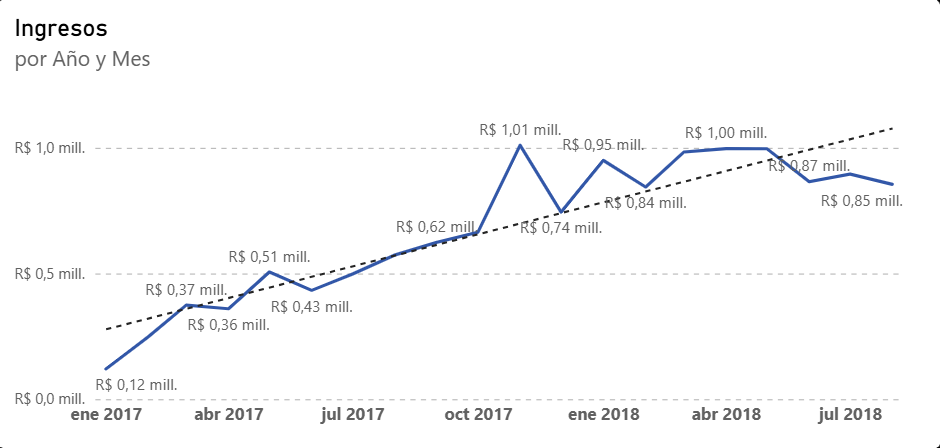
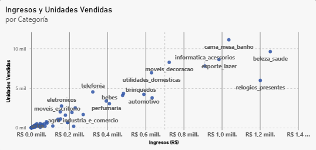
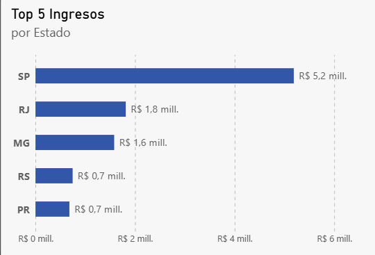
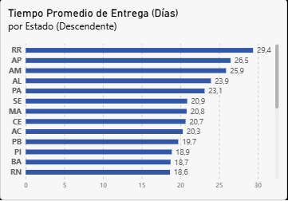
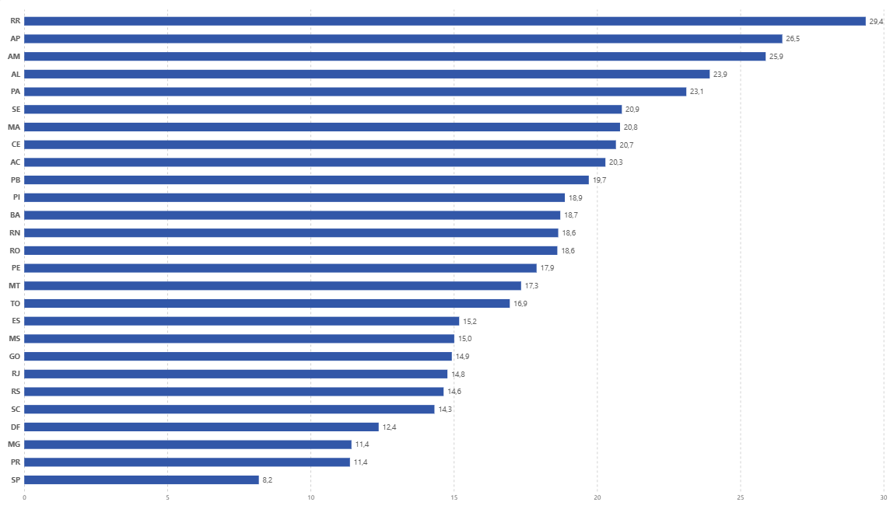

# Gráficas del Dashboard

Este documento explica el funcionamiento de las gráficas que se usaron en el dashboard. 

## Tabla Resumen 

| Gráfica                                        | Campos y medida                                            | Filtro propio   |
| ---------------------------------------------- | ---------------------------------------------------------- | --------------- |
| Ingresos por Año y Mes (línea)                 | `Ingresos Totales`, jerarquía Año y Mes                               |                 |
| Ingresos y Unidades Vendidas por Categoría (dispersión)      | `product_category_name`, `Ingresos Totales`, `Conteo Items Vendidos` |                 |
| Top 5 Ingresos por Estado (barras)             | `customer_state`, `Ingresos Totales`                                 | N superiores: 5 |
| Tiempo Promedio de Entrega (Días) por Estado (Descendente) (barras) | `customer_state`, `Tiempo Promedio de Entrega`             |                 |
| Pedidos por Tipo de Pago (circular)                | `tipo_pago_principal`, `Pedidos Totales`                   |                 |

---
## Contexto de Reporte
Todas las gráficas reaccionan a un filtro global de período, en este caso el período analizado está entre enero del 2017 y agosto del 2018 debido a que hay muy poca información datada de antes y después del período filtrado, por ende para evitar tener información insuficiente y las gráficas o sus líneas de tendencia se distorsionen por falta de datos decidí reducir el período de análisis.
Detalle en [`dax_documentation.md`](dax_documentation.md#contexto-de-reporte).

---
## Descripción de las Gráficas

### Ingresos por Año y Mes

| Campo | Uso |
| ----- | --- |
| Eje X | Año y Mes (jerarquía) basado en `order_purchase_timestamp`|
| Eje Y | `Ingresos Totales` (suma) |

**Qué muestra:** Los ingresos totales que hubo por mes. Cada punto representa el total de ingresos del mes, y la línea punteada es la tendencia.

**Cómo leerla:** Cada punto es un mes, la altura refleja los ingresos totales de ese mes. Las etiquetas muestran el valor del mes. La línea punteada resume la dirección o tendencia general e ignora los picos de un solo mes. 

**Limitación:**
- Los ingresos excluyen el valor del envío (`freight_value`).
- Solo se ven los meses del periodo analizado (ene 2017 – ago 2018).

### Ingresos y Unidades Vendidas por Categoría

| Campo | Uso |
| ----- | --- |
| Valores | `product_category_name` |
| Eje X | `Ingresos Totales` |
| Eje Y | `Conteo Items Vendidos` |

**Qué muestra:** Los ingresos y las unidades vendidas para cada categoría de producto, cada punto representa una categoría donde incluso se ven los nombres en portugués y su posición indica los ingresos totales y las unidades vendidas en el período analizado.

**Cómo leerla:** Los puntos son categorías de productos, el eje X representa los ingresos totales, el eje Y representa las unidades vendidas. Si nos fijamos en un punto en específico, podemos ver una categoría cuántas unidades vendió fijándonos en qué tan alto está y cuántos ingresos recaudó mirando qué tan a la derecha está. 

**Limitaciones:** Si bien se logran ver perfectamente las categorías con más unidades vendidas o ingresos, la mayoría de categorías están en la parte baja, por lo que se ve un cúmulo difícil de analizar individualmente a menos que usemos el filtro de categoría buscando algo en específico. 

### Top 5 Ingresos por Estado

| Campo | Uso | 
| ----- | --- |
| Eje X | `Ingresos Totales`| 
| Eje Y | `customer_state` |

***Filtro propio:*** *Top N 5 superior*

**Qué muestra:** Los cinco estados en que los clientes generaron más ingresos, ordenada de forma descendente.

**Cómo leerla:** El eje Y representa a un estado, el eje X representa el total de ingresos que se recibieron de clientes de ese estado. La barra representa cuánto dinero se recaudó de un estado, entre más lejos a la derecha indica que recaudó más dinero. 

**Limitaciones:** 
- Al ser un top 5 nos perdemos de una visión más general 
- Como está ordenado de forma descendente, no vemos los estados que menos ingresos aportan y no podemos sacar conclusiones de eso.

### Tiempo Promedio de Entrega (Días) por Estado (Descendente)

#### Vista con barra de deslizamiento

#### Vista completa desde `Modo Enfoque`

| Campo | Uso |
| ----- | --- |
| Eje Y | `customer_state` |
| Eje X | `Tiempo Promedio de Entrega`|

**Qué muestra:** El tiempo promedio en días que tarda un pedido en ser entregado desde que se crea la orden de compra hasta que el pedido llega al cliente, todo esto agrupado por estado, está ordenado de forma descendente para ver primero los estados con mayor tiempo promedio de entrega.

**Cómo leerlo:** El eje Y representa los estados, el eje X representa el tiempo promedio en días que se tarda en entregar un pedido, las barras indican cuántos días en promedio tarda un cliente de ese estado en recibir un pedido desde que la orden es creada. 

**Limitaciones:** 
- De un vistazo no se puede ver todo el panorama a menos que se use el `Modo Enfoque` en la gráfica, por lo que se pierde información a simple vista.
- Estados con pocos pedidos (RR, AP, AM) se alteran con facilidad con cualquier pedido que haya tardado mucho.
- Toma en cuenta el tiempo desde que se crea la orden, no desde que se realiza el pago.

### Porcentaje de Pedidos por Tipo de Pago

| Campo | Uso |
| ----- | --- |
| Leyenda | `tipo_pago_principal` |
| Valores | `Pedidos Totales` |

**Qué muestra:** Qué porcentaje de los pedidos se realizan con qué medio de pago.

**Cómo leerlo:** A la derecha se ve la leyenda con su respectivo color que representa un tipo de pago, en el círculo, se ve un área rellena del color que representa a un tipo de pago, a simple vista se puede ver cuál es el área más rellena, pero, para ver la cifra exacta, el área apunta hacia afuera mostrando un porcentaje, que indica el porcentaje de pedidos realizados con ese medio de pago. 

**Limitaciones:** Para evitar problemas de granularidad al crear la tabla analítica, sólo se toma en cuenta un medio de pago por pedido, que sería del primer pago registrado (en caso de que haya tenido varios) y por ende, si alguien utilizó varios métodos de pago sólo se tendrá en cuenta uno en este análisis.